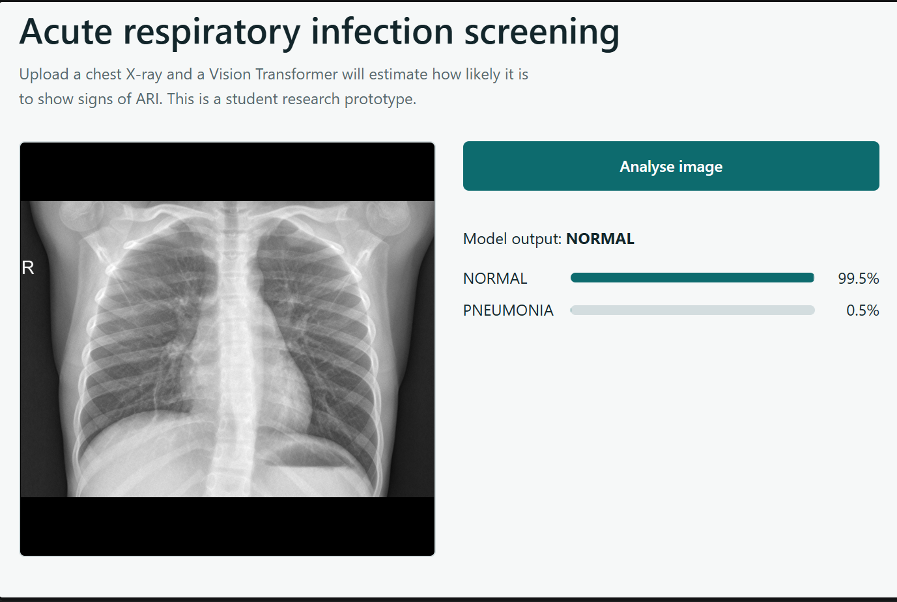

# AI-Powered ARI Detection using Vision Transformer

Fine-tunes a Vision Transformer (ViT-B/16, PyTorch) to classify chest X-ray images for signs of Acute Respiratory
Infection (ARI). Images are preprocessed with OpenCV and NumPy, and a React web page lets you upload an image and see the
prediction.

**Academic prototype. Not a medical device. Not for clinical use.**

**Tech stack:** Python, PyTorch, OpenCV, NumPy, FastAPI, React, HTML, CSS, JavaScript


*Example X-ray shown is from the Chest X-Ray Images (Pneumonia) dataset (Kermany et al., 2018, CC BY 4.0).*

## Results
Evaluated once on the held-out test split of the Chest X-Ray Images (Pneumonia) dataset (624 images: 234 Normal, 390 Pneumonia). The model was selected using the validation split only. Single training run (5 epochs, ViT-B/16 fine-tuned from ImageNet weights).

| Class | Precision | Recall | F1 | Support |
|-------|-----------|--------|----|---------|
| NORMAL | 0.99 | 0.65 | 0.79 | 234 |
| PNEUMONIA | 0.83 | 1.00 | 0.90 | 390 |

Overall test accuracy: **0.87**. ROC-AUC: **0.975**.

Confusion matrix (rows = true class, columns = predicted):

| | Predicted NORMAL | Predicted PNEUMONIA |
|---|---|---|
| True NORMAL | 153 | 81 |
| True PNEUMONIA | 1 | 389 |

The model is very sensitive to pneumonia (389 of 390 detected) but produces many false alarms on normal images (81 of 234). Validation accuracy during training was about 98.7%, noticeably higher than test accuracy, so results on unseen data should be expected to be lower than the validation figures.

## Files
| File | Purpose |
|------|---------|
| `core.py` | preprocessing, augmentation, dataset, ViT model, prediction |
| `train.py` | train the model, saves `checkpoints/best.pt` |
| `evaluate.py` | accuracy, precision/recall, confusion matrix, ROC-AUC on the test split |
| `predict.py` | classify a single image from the command line |
| `app.py` | web server (FastAPI) |
| `static/index.html` | React web page |
| `make_demo_data.py` | creates synthetic demo images for testing that the code runs |

## Data layout
```
data/train/<class>/*.jpg    data/val/<class>/*.jpg    data/test/<class>/*.jpg
```
Class folder names must match in all three splits.

## Demo data
Demo images are not stored in this repository. Run `python make_demo_data.py` to generate 180 synthetic demo images (not real X-rays) for testing that the code runs. All reported results use the real dataset below.

## How to run
```
pip install -r requirements.txt
python train.py --epochs 5
python evaluate.py
uvicorn app:app --reload
```
Then open http://127.0.0.1:8000 and upload a chest X-ray. The trained model file is not included, so run `train.py` first.

## Limitations
- The images are pediatric (ages 1 to 5) chest X-rays from a single hospital, so results may not carry over to adults or other hospitals.
- The dataset has two labels, Normal and Pneumonia. Pneumonia is one form of ARI, so this project detects pneumonia as a stand-in for ARI.
- Output percentages are model scores, not calibrated clinical risk.
- Results come from a single training run on one test set, and the model over-predicts pneumonia on normal images (see the confusion matrix). It has not been validated on any outside dataset.

## Dataset and credit
Chest X-Ray Images (Pneumonia) by Paul Mooney on Kaggle, based on data from:
Kermany, D. S., et al. "Identifying Medical Diagnoses and Treatable Diseases by Image-Based
Deep Learning." Cell 172(5), 2018. http://www.cell.com/cell/fulltext/S0092-8674(18)30154-5

Data: https://data.mendeley.com/datasets/rscbjbr9sj/2
License: CC BY 4.0 (https://creativecommons.org/licenses/by/4.0/)
Changes made: images were resized to 224x224, normalised, and augmented for training, and a
validation split was created from the training images. The images are not included in this repository.